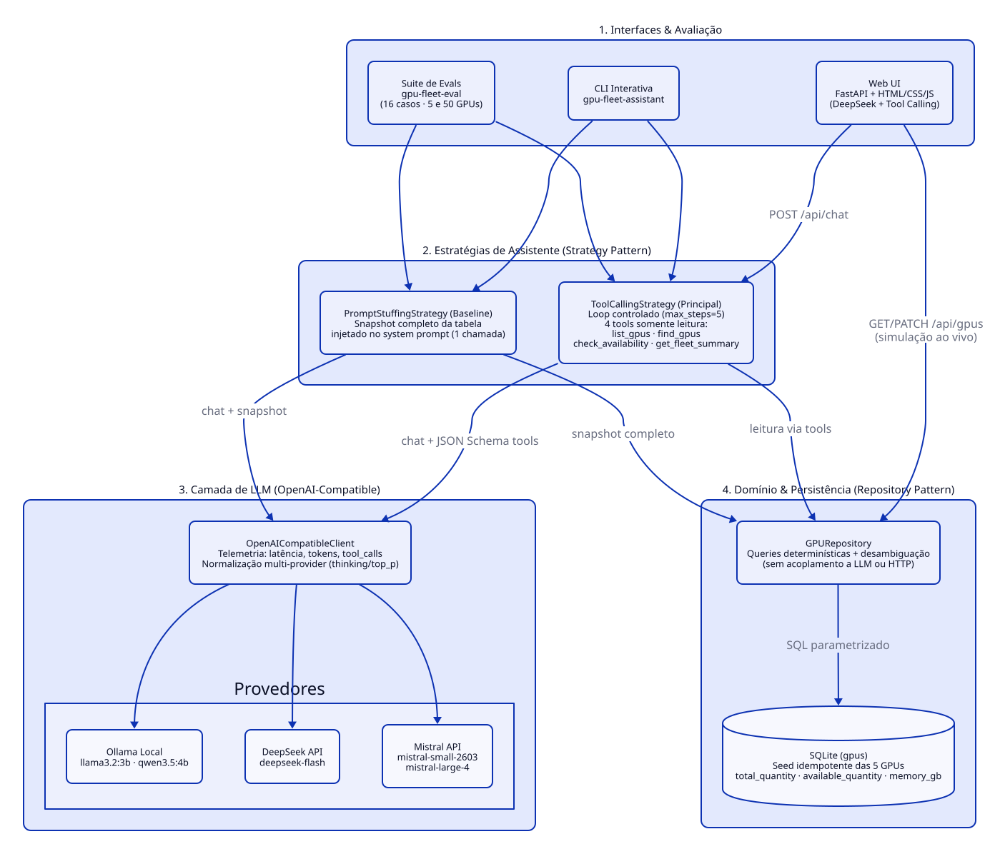

# GPU Fleet Assistant

Assistente conversacional de IA para consultar recursos compartilhados de GPU de um time de ML/AI, desenvolvido para o desafio em [Desafio_2026.md](Desafio_2026.md).

Além de entregar a solução principal com **SQLite + Tool Calling** e interface web em **FastAPI + HTML/CSS/JS**, o projeto implementa uma arquitetura desacoplada (*Strategy pattern*) e uma suite de **avaliação empírica (`evals/`)** comparando **`prompt_stuffing`** (baseline) vs. **`tool_calling`** (arquitetura principal) em **5 modelos de diferentes portes** — locais via Ollama e remotos via API OpenAI-compatible (**160 execuções totais**).

---

## Frota Simulada (Seed SQLite)

Ao inicializar, o banco SQLite é populado de forma idempotente com a infraestrutura definida no desafio:

| GPU | Total | Disponíveis (inicial) | Memória por GPU (GB) | VRAM Total (GB) |
| :--- | :---: | :---: | :---: | :---: |
| `NVIDIA A100` | 4 | 4 | 80 | 320 |
| `NVIDIA L40S` | 6 | 6 | 48 | 288 |
| `NVIDIA RTX 4090` | 3 | 3 | 24 | 72 |
| `NVIDIA H100` | 2 | 2 | 80 | 160 |
| `NVIDIA A40` | 4 | 4 | 48 | 192 |
| **Total** | **19** | **19** | — | **1.032** |

O banco rastreia `total_quantity` e `available_quantity`, permitindo simular GPUs em uso em tempo real pela interface web, testes e evals (sem inventar dados fora do sistema).

---

## Arquitetura e Decisões Técnicas

O código foi organizado em **4 camadas desacopladas** (fonte do diagrama em [docs/diagrams/architecture.d2](docs/diagrams/architecture.d2)):



### Principais decisões
1. **Repository Pattern separado das Tools (`db/repository.py` vs. `strategies/tool_calling.py`)**
   - `GPURepository` encapsula todo acesso ao SQLite e regras de consulta sem conhecer LLMs, prompts ou HTTP.
   - As *tools* do LLM são um adaptador fino **somente leitura** (`list_gpus`, `find_gpus`, `check_availability`, `get_fleet_summary`), seguindo o **princípio do menor privilégio** — operações mutáveis (`set_available_quantity`, `reset_to_seed`) ficam restritas à API/UI e aos testes.
   - `check_availability` detecta e expõe **ambiguidades** (`ambiguous: true` + lista `matches`) em vez de mascarar buscas parciais (como `"L4"` vs. `"L40S"`) como não encontradas.
2. **Cliente LLM agnóstico (`llm/client.py`)**
   - Wrapper fino sobre o SDK oficial `openai` apontando para qualquer endpoint OpenAI-compatible (`ollama`, `deepseek`, `mistral` ou `custom`).
   - Trata diferenças reais entre provedores (ex.: `top_p=1.0` exigido pela Mistral com `temperature=0.0`; extração de texto em respostas com blocos estruturados `thinking` + `text` e remoção de tags `<think>...</think>`).
   - Coleta telemetria padronizada (`latency_ms`, `prompt_tokens`, `completion_tokens`, `total_tokens`, `llm_calls` e traces de *tool calls*).
3. **Estratégias intercambiáveis (`strategies/`)**
   - `PromptStuffingStrategy` (*baseline*): injeta um snapshot atualizado da tabela SQLite no *system prompt* e responde em **1 chamada** ao LLM.
   - `ToolCallingStrategy` (*principal*): executa um loop controlado (`max_steps=5`) com validação estrita de JSON/argumentos, recuperação graciosa de erros e fallback de síntese final.
4. **Anti-alucinação**
   - O assistente responde exclusivamente com base nos dados do SQLite, recusa modelos inexistentes (ex.: `NVIDIA B200`), rejeita especificações incorretas (ex.: `A100 de 40 GB`) e informa claramente pedidos fora de escopo (como reservas futuras).

---

## Avaliação Empírica (`prompt_stuffing` vs. `tool_calling`)

### Metodologia (`src/gpu_fleet_assistant/evals/`)
A bateria contém **16 casos determinísticos** ([dataset.json](src/gpu_fleet_assistant/evals/dataset.json)), cada um rodando sobre um SQLite `:memory:` isolado:
- **12 casos na frota padrão (5 GPUs):** consultas básicas (3), limites e ocupação parcial simulada no SQLite (3), filtros e agregações não pré-calculadas como soma de GPUs `>= 48 GB` (3) e anti-alucinação / fora de escopo (3).
- **4 casos no cenário escalado (`scaled`, 50 GPUs reais):** adiciona **45 modelos reais de NVIDIA, AMD e Intel** (de 8 GB a 192 GB) para testar busca em tabela maior, filtro multi-vendor `>= 100 GB` (`H200`, `MI300X`, `MI250X`, `Max 1550`), desambiguação `L4`/`L40`/`L40S` e filtro combinado `Intel >= 48 GB`.

### Resultados Consolidados (**5 modelos × 2 estratégias × 16 casos = 160 execuções**, 0 erros)

| Modelo | Ambiente / Tipo | Estratégia | Acurácia (16 casos) | 50 GPUs reais (`scaled`) | Latência Média | Total Tokens (média) | Chamadas LLM |
| :--- | :--- | :--- | :---: | :---: | :---: | :---: | :---: |
| `llama3.2:3b` | Local 3B (Ollama) | `prompt_stuffing` | 10/16 (62.5%) | 1/4 (25%) | 841 ms | 734 | 1.00 |
| `llama3.2:3b` | Local 3B (Ollama) | `tool_calling` | 11/16 (68.8%) | **3/4 (75%)** | 1.193 ms | 1.427 | 2.00 |
| `qwen3.5:4b` | Local 4B (*thinking*) | `prompt_stuffing` | 14/16 (87.5%) | 4/4 (100%) | 21.512 ms | 1.718 | 1.00 |
| `qwen3.5:4b` | Local 4B (*thinking*) | `tool_calling` | **16/16 (100.0%)** | **4/4 (100%)** | **7.587 ms** | 2.361 | 1.94 |
| `mistral-small-2603` | API compacto | `prompt_stuffing` | 16/16 (100.0%) | 4/4 (100%) | 1.003 ms | 840 | 1.00 |
| `mistral-small-2603` | API compacto | `tool_calling` | **16/16 (100.0%)** | **4/4 (100%)** | **1.487 ms** | 1.894 | 1.94 |
| `deepseek-flash` | API médio | `prompt_stuffing` | 16/16 (100.0%) | 4/4 (100%) | 2.025 ms | 893 | 1.00 |
| `deepseek-flash` | API médio | `tool_calling` | **16/16 (100.0%)** | **4/4 (100%)** | 3.212 ms | 2.614 | 2.06 |
| `mistral-large-4` | API grande (*thinking*) | `prompt_stuffing` | 15/16 (93.8%)\* | 3/4\* | 3.795 ms | 956 | 1.00 |
| `mistral-large-4` | API grande (*thinking*) | `tool_calling` | **16/16 (100.0%)** | **4/4 (100%)** | 5.348 ms | 2.040 | 2.06 |

*\*Nota de revisão dos traces:* o único FAIL heurístico do `mistral-large-4` em `prompt_stuffing` (`scaled_intel_ge_48gb`) ocorreu por citar os modelos menores da Intel (`Flex 170`, `Flex 140`, `A770`, `A750`) ao explicar por que ficaram fora do filtro. Os relatórios completos (`.md` e `.json`) estão em [docs/evals/](docs/evals/).

### Principais conclusões empíricas
1. **Modelos locais pequenos ganham drasticamente com `tool_calling`:**
   - No `llama3.2:3b`, o acerto no cenário de 50 GPUs reais triplicou (`25% → 75%`), acertando o filtro multi-vendor `>= 100 GB` que falhava no `prompt_stuffing`.
   - No `qwen3.5:4b` (4B local com *thinking* nativo), `tool_calling` não só atingiu **16/16 (100%)**, como foi **2,8× mais rápido** que `prompt_stuffing` (`7,6s` vs. `21,5s`): delegar filtros ao SQLite cortou os tokens de raciocínio interno em ~3×.
2. **Quando `prompt_stuffing` compensa (sem dogma):**
   - Para tabelas pequenas e estáticas com modelos modernos via API (`mistral-small-2603`, `deepseek-flash`), `prompt_stuffing` também atingiu 100% com **1 chamada**, **~1,5× menor latência** e **~2–3× menos tokens** (sem overhead dos schemas das tools).
3. **Por que `tool_calling` é a arquitetura recomendada:**
   - Garante **filtragem determinística via SQL**, **custo de contexto estável** conforme o inventário cresce, **isolamento de permissões** e caminho direto para evoluir para ações transacionais (como reservas de GPU).
4. **Custo-benefício entre modelos (*nota metodológica sobre thinking*):**
   - `mistral-large-4` e `qwen3.5:4b` operaram com *thinking* nativo ativo, elevando latência e `completion_tokens`. Com `tool_calling`, um modelo compacto sem *thinking* (`mistral-small-2603`) atingiu os mesmos **100% (16/16)** em apenas **1,49s** de média.

---

## Como Executar

### Pré-requisitos
- Python `>= 3.14`
- [`uv`](https://docs.astral.sh/uv/) instalado
- Um modelo local no **Ollama** (ex.: `ollama pull qwen3.5:4b` ou `llama3.2:3b`) **ou** uma chave de API OpenAI-compatible (DeepSeek / Mistral / custom).

### 1. Instalar dependências e configurar `.env`
```bash
uv sync
cp .env.example .env
```

Edite `.env` conforme o provedor desejado (`LLM_PROVIDER=ollama`, `deepseek`, `mistral` ou `custom`). Para Ollama local, nenhuma chave de API é necessária.

### 2. Interface Web (FastAPI + HTML/CSS/JS)
```bash
uv run gpu-fleet-web
```
Acesse `http://127.0.0.1:8000` (e a documentação interativa OpenAPI em `http://127.0.0.1:8000/docs`).

Recursos da interface:
- Painel ao vivo da frota SQLite com botões **`−` / `+`** e **Resetar frota** para simular GPUs ocupadas em tempo real;
- Chat configurado com a arquitetura principal (**DeepSeek + Tool Calling**);
- Barra de telemetria por resposta (`latency_ms`, `tokens`, `llm_calls`) e **inspetor expansível de *tool calls*** (argumentos e JSON retornado);
- Alternância entre tema escuro e tema claro.

### 3. CLI Interativa
```bash
uv run gpu-fleet-assistant
uv run gpu-fleet-assistant --strategy prompt_stuffing --provider ollama --model llama3.2:3b
uv run gpu-fleet-assistant --strategy tool_calling --provider mistral --model mistral-small-2603
```

### 4. Suite Comparativa de Evals
```bash
# Frota padrão (12 casos) ou completa com 50 GPUs reais (16 casos)
uv run gpu-fleet-eval --provider ollama --model qwen3.5:4b --scenario all
uv run gpu-fleet-eval --provider deepseek --scenario all --output-md docs/evals/eval_deepseek.md
uv run gpu-fleet-eval --provider mistral --model mistral-small-2603 --scenario all
```

### 5. Testes Automatizados (sem depender de rede ou LLM)
```bash
uv run pytest -v
```
Todos os **35 testes unitários** usam SQLite `:memory:` e clientes LLM mockados, cobrindo repositório, configuração multi-provider, `PromptStuffingStrategy`, `ToolCallingStrategy`, avaliador e endpoints FastAPI.

---

## Estrutura do Projeto

```text
gpu-fleet-assistant/
├── Desafio_2026.md
├── .env.example
├── pyproject.toml
├── docs/
│   ├── diagrams/                   # Diagrama de arquitetura em D2 (`architecture.d2` e `architecture.svg`)
│   └── evals/                      # Índice e relatórios empíricos (.md e .json) dos 5 modelos
├── src/gpu_fleet_assistant/
│   ├── config.py                   # Configuração multi-provider (.env)
│   ├── cli.py                      # CLI interativa (`gpu-fleet-assistant`)
│   ├── db/
│   │   ├── models.py               # GPUResource, AvailabilityCheck, FleetSummary
│   │   ├── schema.py               # Schema SQLite + seed idempotente das 5 GPUs
│   │   └── repository.py           # GPURepository (queries determinísticas)
│   ├── llm/
│   │   └── client.py               # OpenAICompatibleClient + normalização multi-provider
│   ├── strategies/
│   │   ├── base.py                 # AssistantStrategy, ChatMessage, AssistantResponse
│   │   ├── prompt_stuffing.py      # Baseline: snapshot SQLite no system prompt
│   │   └── tool_calling.py         # Principal: tools tipadas de leitura + loop controlado
│   ├── evals/
│   │   ├── dataset.json            # 16 casos (12 padrão + 4 escalados)
│   │   ├── dataset.py              # Loader + frota heterogênea de 50 GPUs reais
│   │   ├── evaluator.py            # Scoring determinístico e relatório Markdown
│   │   └── runner.py               # CLI de benchmark (`gpu-fleet-eval`)
│   └── web/
│       ├── app.py                  # API FastAPI (`gpu-fleet-web`)
│       └── static/                 # Frontend HTML/CSS/JS puro
└── tests/                          # 35 testes unitários determinísticos
```

---

## Próximos Passos (Evoluções Futuras)

- **Reservas com janela de tempo:** adicionar tabela `reservations` no SQLite e tools transacionais (`reserve_gpu`, `cancel_reservation`) com verificação de conflito (*double-booking*).
- **Streaming via SSE (`POST /api/chat/stream`):** reduzir o tempo até o primeiro token (TTFT) e exibir o status de cada *tool call* em tempo real na interface.
- **Deploy conteinerizado:** `Dockerfile` expondo a porta `7860`/`8000` com `GPU_FLEET_DB_PATH=/tmp/gpu_fleet.db` para publicação em Hugging Face Spaces ou Render.
